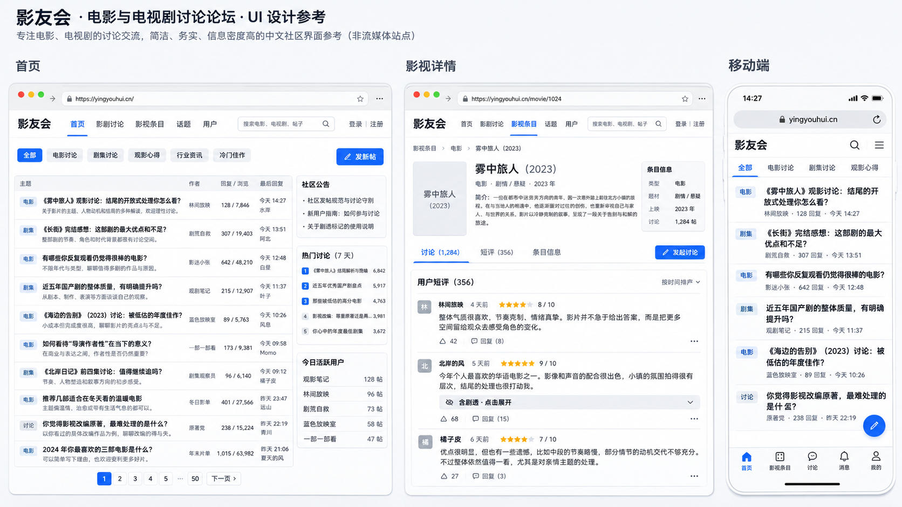

# 影视论坛效果图说明

> 本文件是视觉参考，不是已实现页面或验收证明；功能与范围以《影视论坛-项目白皮书与总体方案.md》及用户确认的阶段计划为准。

## 画面包含

1. **桌面首页**：紧凑导航、分类标签、以帖子列表为主的内容区与右侧辅助栏。
2. **影视详情**：简洁的作品资料、讨论与影评；剧透应先提示，由用户主动展开。
3. **移动端**：单栏列表与易点击的导航，不能简单缩小桌面页面。

## 交付与实现约束

- “影友会”、画面中的域名、影片、用户、数字和评分均为图示占位，并非确定品牌、真实用户或真实数据；最终名称和域名由用户确定，不得将图中域名作为真实链接。
- 效果图里的评分、底部消息入口、活跃用户榜、影片标签等仅为视觉示意，**不是新增需求**；仅实现阶段计划明确授权的功能，未实现入口不得伪装可用。
- 影片海报使用纯色占位示意；不得擅自复制或抓取受版权保护的海报、剧照和影视素材。
- 当前仅提供浅色视觉参考；深色模式、键盘操作、焦点、剧透不泄露和移动端适配以白皮书及审计方案为准，不以效果图代替验证。
- 首页优先帖子信息流；不做在线播放、视频资源、巨型 Banner、影视商城或大面积渐变。
- 图像由 AI 生成，部分文字可能失真；布局、信息层次与风格为参考，文案、路由及数据以经过确认的需求和真实实现为准。

## 建议验收

开发 Agent 应在用户确认原型后，以桌面和手机实际浏览器截图对比信息密度、布局、视觉层级、响应式与主题；对照结果和偏差写入阶段验收证据。图片本身不证明页面已经完成或测试通过。
